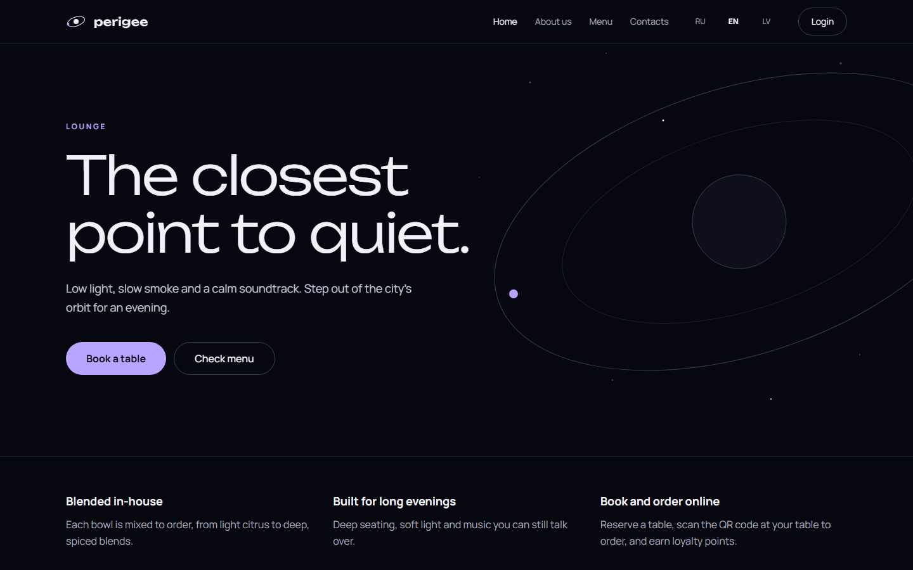
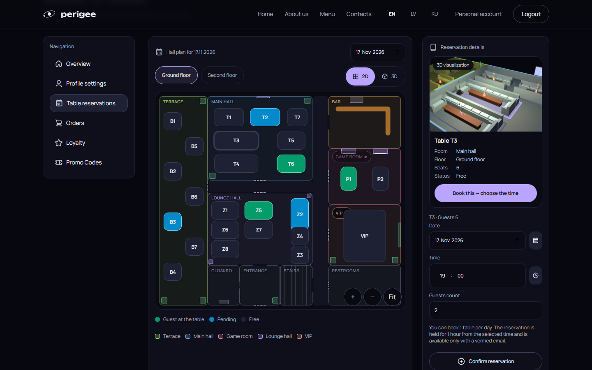
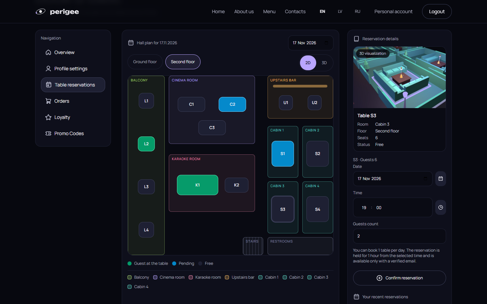
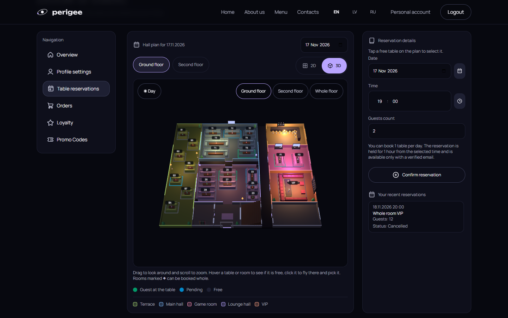
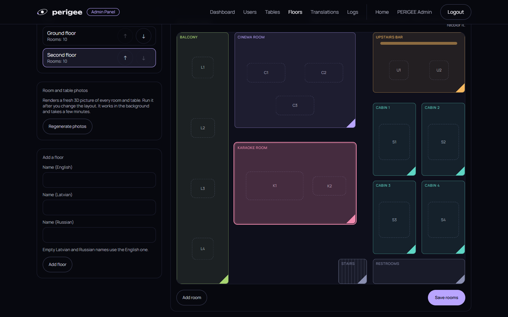
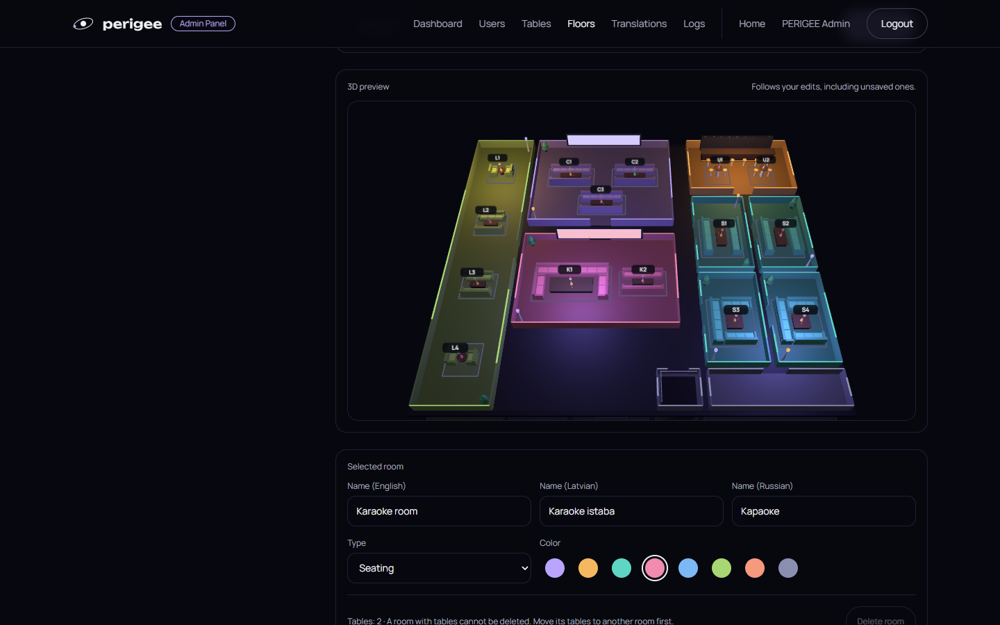
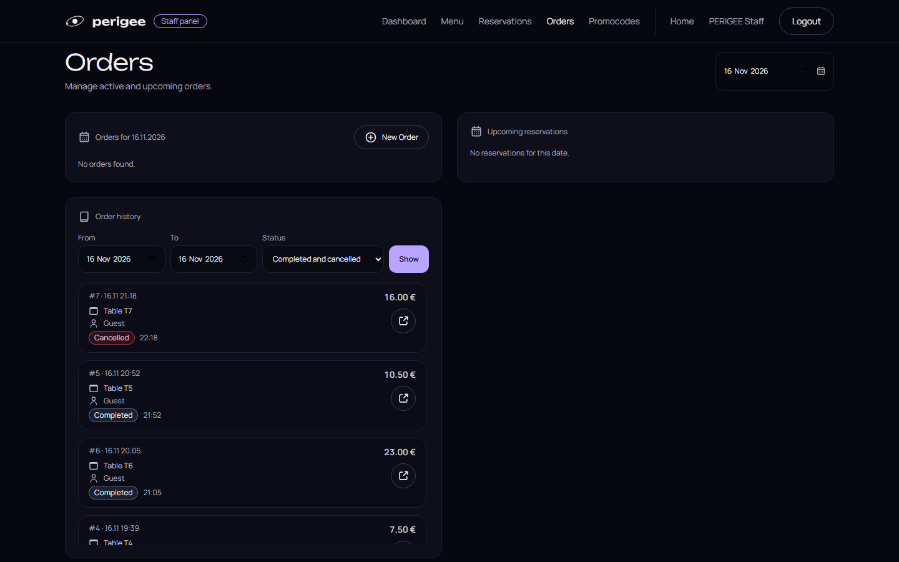

# Perigee Lounge

[](https://github.com/Bracka1337/perigee-lounge/actions/workflows/ci.yml)

A website and management system for a fictional hookah lounge. Guests browse the menu and book tables, order from their table by QR code, and collect loyalty points. Staff run orders, reservations and promo codes, and admins manage users, floors, rooms, tables and translations. The lounge has two floors that can be browsed on a 2D plan or in 3D. The site is available in English, Latvian and Russian.



**Booking a table: ground floor, second floor and the 3D view**

The panel on the right shows the selected table with its generated picture.

| Ground floor | Second floor |
|---|---|
|  |  |



**Floors and rooms editor, with a live 3D preview**

| Plan editor | 3D preview |
|---|---|
|  |  |

| Menu with generated photos | Table ordering on a phone | Staff reservations |
|---|---|---|
|  |  |  |

**Staff order history**



## Features

**Guests and clients**
- Public pages and a database-driven menu in three languages, under `/en`, `/lv` and `/ru`, with English as the default
- Menu photos in a 4:3 frame with a placeholder for items without one, and an available-only filter
- Table reservations on a floor plan, checked against opening hours and existing bookings
- Two floors with floor tabs, rooms drawn from the database and a legend built from them
- A 3D view of the lounge (three.js) on large screens: orbit, zoom, a floor cutaway, and tables picked like on the 2D plan
- A panel for the selected table with its generated picture, room, floor, seats and status
- QR table ordering with a cart
- Loyalty balance and promo codes with QR codes

**Staff**
- Orders, reservations and the floor plan, with the same floor tabs
- Order history filtered by date range and status, with pagination
- Menu management with drag-and-drop sorting and photo uploads, resized into a full-size copy and a thumbnail
- One-click availability toggles for menu items
- Promo codes with percent or fixed discounts, limited to a category or item
- QR scanner for loyalty and promo codes

**Admins**
- Dashboard with charts
- Users, tables and opening hours
- Floors and rooms: add, rename, reorder and delete floors, and draw rooms on a plan editor (drag, resize, rename, recolor) with a live 3D preview. Rooms with tables and floors with rooms can't be deleted.
- A "Regenerate photos" button that re-renders every room and table picture in the background
- Translation editor and activity log

## Generated pictures

The room, table and menu pictures are not photos. A local render studio draws each one as a low-poly three.js scene and a headless browser photographs it. A default set ships in `database/seeders/renders`, and `php artisan db:seed` installs it for anything without a picture.

```bash
php artisan perigee:render-lounge   # every room and table
php artisan perigee:render-menu     # menu items without a photo
```

- **Where it runs:** the studio is available when `APP_ENV=local` or `RENDER_STUDIO=true`. It needs Node.js and Chrome (or `npx playwright install chromium`).
- **Address:** the commands load the studio from `APP_URL`. Pass `--url=` if the app is served elsewhere.
- **Staff photos are kept:** `perigee:render-menu` never replaces a photo that staff uploaded, even with `--force`.
- **Same output every time:** every scene is seeded, so a re-render looks the same.

## Stack

Laravel 13, PHP 8.3, Blade, Tailwind CSS 4, Vite 8, three.js, Pest 4, Pint, Larastan (PHPStan level 8) and GitHub Actions. Uses SQLite locally, with a Docker setup for MySQL and Nginx.

## Getting started

You need PHP 8.3 or newer with the `gd` extension, Composer, and Node.js 22 or newer.

```bash
git clone https://github.com/Bracka1337/perigee-lounge.git
cd perigee-lounge
composer setup
php artisan db:seed
composer dev
```

Then open http://localhost:8000. `composer dev` also runs the queue worker (mail and Telegram messages) and the scheduler (expiring late reservations and refreshing the disposable-email domain list weekly).

Demo accounts, for local use only:

| Role | Email | Password |
|---|---|---|
| Admin | `admin@perigee.test` | `password` |
| Staff | `staff@perigee.test` | `password` |

Register a new account to try the client side. Email is written to the log by default, so the verification link is in `storage/logs/laravel.log`.

## Running with Docker

One command builds and starts the site with MySQL and Nginx. No `.env` or local
PHP and Node are needed:

```bash
docker compose up -d --build
```

Open http://localhost:8081 (set `APP_PORT` to use another port). The first start
migrates and seeds the database, then serves the app. The demo accounts above
work the same way.

- `app`: PHP-FPM. The code, Composer dependencies and built assets are baked
  into the image, so rebuild after code changes (`docker compose up -d --build`).
- `queue` and `scheduler`: the same image, running the queue worker and the scheduler.
- `nginx`: serves `public/` and passes PHP requests to `app`.
- `db`: MySQL 8.4, also reachable from the host on port 33061 (`DB_FORWARD_PORT`).

The database and `storage/` (uploaded menu photos, logs, the generated app key)
live in named volumes, so restarts keep your data and the demo data is seeded
only into a database with no users. `docker compose down -v` deletes both
volumes for a fresh start. Mail is written to `storage/logs/laravel.log`
(`docker compose exec app tail storage/logs/laravel.log`).

## Architecture

- **Controllers stay thin.** Each one validates with a Form Request, checks access, calls one action and returns a response.
- **Actions** in `app/Actions` hold the business operations, one class each: `OpenTableOrder`, `OpenReservationOrder`, `CompleteOrder`, `ApplyPromoCode`, `SpendLoyaltyPoints`, `ConfirmTableCart`, `CreateStaffReservation` and others. Opening an order for a reservation and completing an order are shared by the order and reservation screens. When a rule blocks an action, it throws a `BusinessRuleException` carrying a translation key, and the user is sent back with that message.
- **Services** hold what isn't a single operation: `TableCart` (the QR-table cart in the session), `TelegramNotifier`, `LoungeLayout` (floors, rooms and tables for every page that draws the plan) and `RenderStudio`.
- **One layout, two views:** the 2D plan and the 3D view are built from the same floors, rooms and tables. The 3D code (`resources/js/lounge3d`) is a separate chunk that is downloaded only when the 3D view is opened. Picking a table in 3D clicks its 2D button, so availability and the form behave the same in both.
- **Default layout as data:** `database/data/lounge-layout.php` holds both floors. The seeders and a data migration write it with `ApplyDefaultLayout`, which moves existing tables and keeps their ids, so reservations and orders still point to them.
- **Authorization:** route groups use `can:admin`, `can:staff` and `can:client` gates. `OrderPolicy`, `ReservationPolicy` and `UserPolicy` cover per-record rules, such as a client seeing only their own orders (others get a 404) or staff cancelling only phone and walk-in bookings.
- **Statuses** are backed enums (`OrderStatus`, `ReservationStatus`) cast on the models.
- **Locale routing:** every page sits under `/{locale}`. `SetLocale` validates the prefix, sets it as the URL default so `route()` calls don't need it, and remembers it on the user. A path without a locale gets a 301 redirect to English, the default language.
- **Translations from the database:** `DatabaseTranslator` extends Laravel's translator and reads interface text from a `translations` table, cached per key, so admins can edit any text on the site. Defaults live in `DefaultTranslationsSeeder`, and `php artisan translations:sync` adds new keys without overwriting edited ones.
- **Activity log:** a `LogsActivity` trait records create, update and delete events on the main models for the admin log.
- **Guard rails:** outside production, `Model::shouldBeStrict()` turns lazy loading (N+1), unknown attributes and dropped mass assignment into errors. Larastan runs at level 8 with no baseline, and bans debug calls (`dd()`, `dump()`, `var_dump()`, `print_r()`, `ray()`) and `env()` outside config files.
- **Design tokens:** colours and fonts are defined once in `resources/css/app.css` through Tailwind's `@theme`.
- **Queue and scheduler:** mail and Telegram messages are queued, so a slow mail server or Telegram API never holds up a guest. Every five minutes, `reservations:expire` expires bookings the guest is more than an hour late for.
- **Telegram:** optional staff notifications for QR orders and reservations, set up with the `TELEGRAM_*` values in `.env`. Messages use `TELEGRAM_LOCALE` (default: the site language) and escape guest input.

## Tests

```bash
composer test          # Pest, in parallel: feature and browser tests
vendor/bin/pint --test
composer stan          # Larastan, level 8, no baseline
npm run build
```

Browser tests (`tests/Browser`) use Pest 4 with Playwright and cover the flows that need JavaScript: QR table ordering from menu to confirmation, the menu category highlight, drag-and-drop category sorting, and JavaScript errors at phone width. Install the browser once with `npx playwright install chromium`.

GitHub Actions runs all of these on every pull request.
