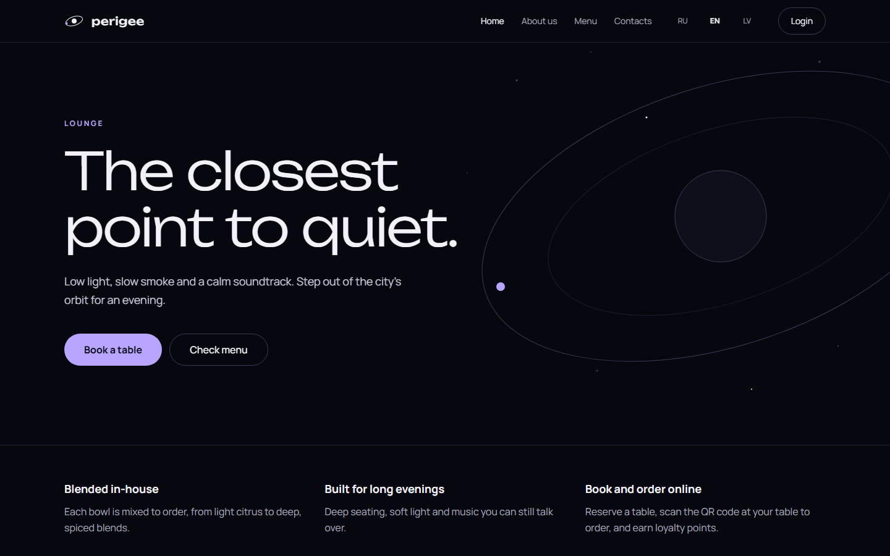
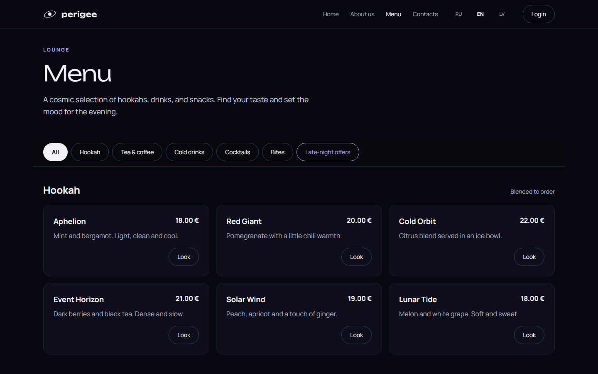
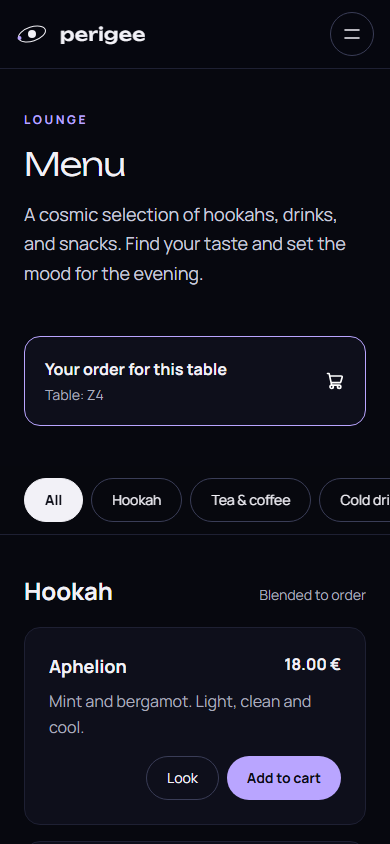
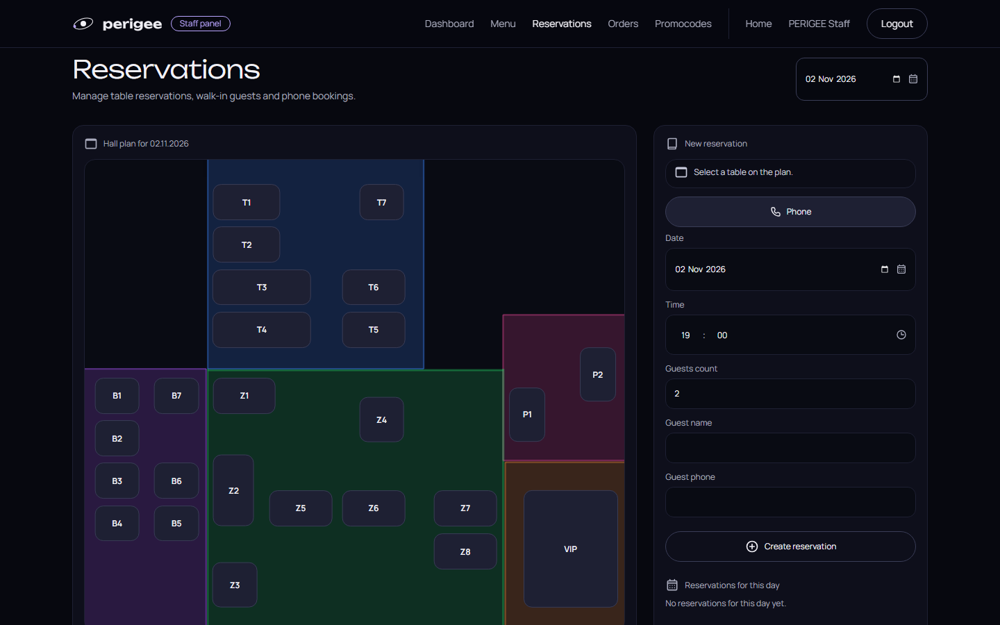

# Perigee Lounge

[](https://github.com/Bracka1337/perigee-lounge/actions/workflows/ci.yml)

A website and management system for a fictional hookah lounge. Guests browse the menu and book tables, order from their table by QR code, and collect loyalty points. Staff run orders, reservations and promo codes, and admins manage users, tables and translations. The site is available in English, Latvian and Russian.



| Menu | Table ordering on a phone | Staff reservations |
|---|---|---|
|  |  |  |

## Features

**Guests and clients**
- Public pages and a database-driven menu in three languages, under `/en`, `/lv` and `/ru`
- Table reservations on a floor plan, checked against opening hours and existing bookings
- QR table ordering with a cart
- Loyalty balance and promo codes with QR codes

**Staff**
- Orders, reservations and floor plan
- Menu management with drag-and-drop sorting and image uploads
- Promo codes with percent or fixed discounts, limited to a category or item
- QR scanner for loyalty and promo codes

**Admins**
- Dashboard with charts
- Users, tables and opening hours
- Translation editor and activity log

## Stack

Laravel 13, PHP 8.3, Blade, Tailwind CSS 4, Vite 8, Pest 4, Pint, Larastan (PHPStan level 8) and GitHub Actions. Uses SQLite locally, with a Docker setup for MySQL and Nginx.

## Getting started

You need PHP 8.3 or newer with the `gd` extension, Composer, and Node.js 22 or newer.

```bash
git clone https://github.com/Bracka1337/perigee-lounge.git
cd perigee-lounge
composer setup
php artisan db:seed
composer dev
```

Then open http://localhost:8000. `composer dev` also runs the queue worker (mail and Telegram messages) and the scheduler (expiring late reservations).

Demo accounts, for local use only:

| Role | Email | Password |
|---|---|---|
| Admin | `admin@perigee.test` | `password` |
| Staff | `staff@perigee.test` | `password` |

Register a new account to try the client side. Email is written to the log by default, so the verification link is in `storage/logs/laravel.log`.

## Architecture

- **Controllers stay thin.** Each one validates with a Form Request, checks access, calls one action and returns a response.
- **Actions** in `app/Actions` hold the business operations, one class each: `OpenTableOrder`, `OpenReservationOrder`, `CompleteOrder`, `ApplyPromoCode`, `SpendLoyaltyPoints`, `ConfirmTableCart`, `CreateStaffReservation` and others. Opening an order for a reservation and completing an order are shared by the order and reservation screens. When a rule blocks an action, it throws a `BusinessRuleException` carrying a translation key, and the user is sent back with that message.
- **Services** hold what isn't a single operation: `TableCart` (the QR-table cart in the session) and `TelegramNotifier`.
- **Authorization:** route groups use `can:admin`, `can:staff` and `can:client` gates. `OrderPolicy`, `ReservationPolicy` and `UserPolicy` cover per-record rules, such as a client seeing only their own orders (others get a 404) or staff cancelling only phone and walk-in bookings.
- **Statuses** are backed enums (`OrderStatus`, `ReservationStatus`) cast on the models.
- **Locale routing:** every page sits under `/{locale}`. `SetLocale` validates the prefix, sets it as the URL default so `route()` calls don't need it, and remembers it on the user. A path without a locale gets a 301 redirect to the default language.
- **Translations from the database:** `DatabaseTranslator` extends Laravel's translator and reads interface text from a `translations` table, cached per key, so admins can edit any text on the site. Defaults live in `DefaultTranslationsSeeder`, and `php artisan translations:sync` adds new keys without overwriting edited ones.
- **Activity log:** a `LogsActivity` trait records create, update and delete events on the main models for the admin log.
- **Guard rails:** outside production, `Model::shouldBeStrict()` turns lazy loading (N+1), unknown attributes and dropped mass assignment into errors. Larastan runs at level 8 with no baseline, and bans `dd()`, `dump()` and `env()` outside config files.
- **Design tokens:** colours and fonts are defined once in `resources/css/app.css` through Tailwind's `@theme`.
- **Queue and scheduler:** mail and Telegram messages are queued, so a slow mail server or Telegram API never holds up a guest. Every five minutes, `reservations:expire` expires bookings the guest is more than an hour late for.
- **Telegram:** optional staff notifications for QR orders and reservations, set up with the `TELEGRAM_*` values in `.env`. Messages use `TELEGRAM_LOCALE` (default: the site language) and escape guest input.

## Tests

```bash
composer test          # Pest, in parallel: feature and browser tests
vendor/bin/pint --test
composer stan          # Larastan, level 8, no baseline
npm run build
```

Browser tests (`tests/Browser`) use Pest 4 with Playwright and cover the flows that need JavaScript: QR table ordering from menu to confirmation, the menu category highlight, drag-and-drop category sorting, and JavaScript errors at phone width. Install the browser once with `npx playwright install chromium`.

GitHub Actions runs all of these on every pull request. Dependabot opens weekly grouped updates for Composer, npm and Actions.
